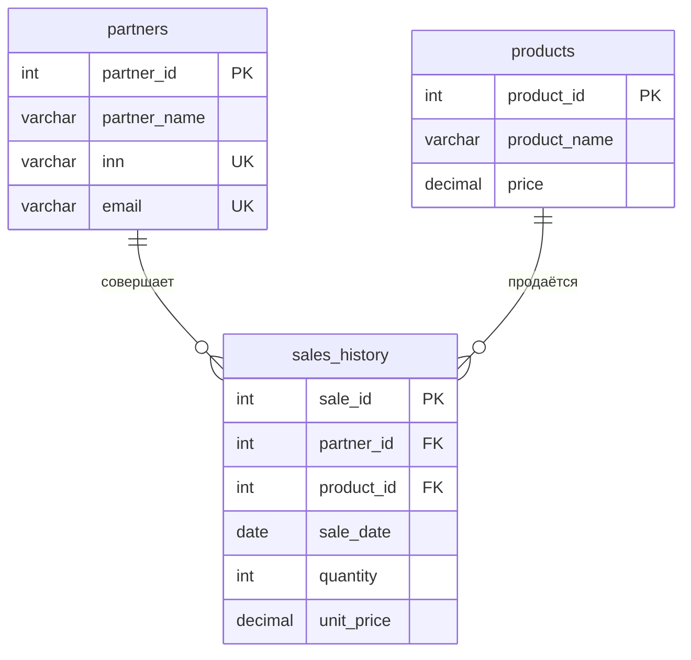

# Инфраструктура данных и ETL (База данных в 3NF)

Первое задание блока 05.10.2026. Подготовлена отдельная база PostgreSQL `practice_051026`
для новых исходных файлов. Рабочая база прежней CRM `partner_shipments` не изменяется.

## Схема в 3NF

- `partners`: partner_id определяет название, ИНН и email. ИНН и email уникальны.
- `products`: product_id определяет название и текущую справочную цену DECIMAL(14,2).
- `sales_history`: sale_id определяет партнёра, товар, дату, количество и историческую цену DECIMAL(18,4).

Все значения атомарны; первичные ключи одноатрибутные, частичных зависимостей нет.
Неключевые атрибуты описывают запись своей таблицы и не зависят транзитивно от других неключевых атрибутов.
Названия партнёров и товаров в историю не копируются. Единый стиль — snake_case.

В исходной истории есть `amount`. ETL получает цену сделки как `amount / quantity` с точностью
до четырёх знаков и проверяет обратное восстановление суммы до копейки. В данном наборе суммы
восстанавливаются точно. `amount` выводится через представление `sales_history_details` как
`round(quantity * unit_price, 2)`, поэтому дублирующее вычисляемое значение не хранится.
Историческая цена зависит от сделки, а не только от product_id: изменение текущей цены товара
не меняет сумму прошлых продаж.

В DDL заданы PRIMARY KEY, NOT NULL, UNIQUE, FOREIGN KEY с ON DELETE RESTRICT / ON UPDATE RESTRICT.
Дополнительно проверяются положительные ID и количества, неотрицательные цены, формат ИНН,
email без пробелов в нижнем регистре и непустые названия. Уникальность названий товаров не навязывается:
разные товары могут иметь одинаковое отображаемое имя.

## Очистка и контроль

| Файл | Входных строк | Импортируется | Что исправлено |
| --- | ---: | ---: | --- |
| partners_raw.csv | 5 | 5 | Пробелы по краям, двойной пробел в имени; email приведены к нижнему регистру |
| products_raw.csv | 3 | 3 | Windows-1251 прочитан без потери кириллицы, пробелы удалены, цены нормализованы |
| sales_history_raw.csv | 6 | 5 | Пять форматов дат приведены к ISO, исключена продажа с неверной ссылкой |

Все подготовленные CSV записаны в UTF-8. Для TRIM используется `strip()`, для повторяющихся
пробельных символов в названиях — `" ".join(value.split())`. Даты проверяются через strptime
по форматам `%Y-%m-%d`, `%d.%m.%Y`, `%Y/%m/%d`, `%d-%m-%Y`, `%Y.%m.%d`.
Некорректный календарный день не исправляется угадыванием, а отклоняется.

Продажа **1003** с `partner_id=999` исключена из загрузки и сохранена в rejected_rows.csv
с исходными значениями и причиной. Подставной партнёр не создавался.
Дубликатов в предоставленном наборе не обнаружено. Полные повторы с одним ID пропускаются
и отражаются в отчёте; конфликтующие ID, ИНН или email отправляются на ручную проверку.

В названии партнёра 2 сохранено многоточие: `ИП ...Петров A.B.`. Исправлены только пробелы.
Нельзя достоверно восстановить пунктуацию и алфавит инициалов без подтверждения первоисточника;
эта запись отмечена в разделе review отчёта.

Итог: **5 партнёров, 3 товара, 5 продаж, 17 единиц продукции, сумма 530202.00**.
SHA-256 исходников, кодировки, изменения отдельных полей и исключённые строки — в etl_report.json.
Копии исходников в raw сохранены побайтно; файлы в Downloads не изменялись.

## Запуск через VS Code

1. Откройте всю папку hexlet.
2. Откройте `run_import.py` из этого задания и нажмите **Run Python File**.
3. В терминале введите пароль PostgreSQL, который используете в pgAdmin; ввод скрыт.
4. Скрипт создаст `practice_051026`, развернёт schema.sql и импортирует подготовленные записи
   одной транзакцией. Настройки сервера находятся в database.ini.
5. Ожидаемые строки результата: partners: 5, products: 3, sales_history: 5.

Скрипт автоматически использует `.venv` из корня проекта. При первом скачивании проекта
создайте окружение в VS Code и установите зависимости из requirements.txt.
ETL отдельно запускается через etl.py; для безопасного экспорта data.sql используется
Psycopg из requirements.txt. Существующее окружение .venv выбирается автоматически.

Повторный запуск run_import.py сравнит уже загруженные записи с подготовленным набором.
Если набор совпадает, повторная вставка не выполняется. При других данных или частичной схеме
скрипт останавливается без удаления таблиц. Если сервер не подключается, проверьте службу
PostgreSQL, пароль, адрес и порт; для создания базы требуется право CREATEDB.

## Вариант вручную в pgAdmin, без командной строки

Выберите один способ импорта: Python выше или следующие действия.

1. В дереве сервера PostgreSQL нажмите правой кнопкой **Databases → Create → Database**.
   Название базы — `practice_051026`. Нажмите Save.
   Вместо мастера можно выполнить create_database.sql в Query Tool базы postgres.
2. Выберите именно новую базу **practice_051026 → Query Tool**.
3. Через значок папки откройте **schema.sql**. Выполните весь файл кнопкой Execute/F5.
4. В этой же базе откройте **data.sql** и выполните весь файл. Он содержит очищенные данные
   и настройку identity-последовательностей после вставки явных ID.
5. Откройте **checks.sql**. Первый SELECT покажет количества 5, 3, 5; остальные проверят
   итоговую сумму, отсутствие битых ссылок и совпадение сумм каждой продажи.
6. Обновите узел **Schemas → public → Tables**: появятся partners, products и sales_history.
   В Views находится sales_history_details.

schema.sql и data.sql рассчитаны на первоначальное выполнение в пустой базе.
Для повторной сверки используйте checks.sql; скрипты не удаляют существующие таблицы.
Если использован run_import.py, вручную выполнять schema.sql и data.sql уже не нужно.

## Файлы задания

| Файл или папка | Назначение |
| --- | --- |
| raw/ | Неизменённые копии трёх исходных файлов |
| cleaned/ | Три подготовленных CSV в UTF-8 для БД |
| etl.py | Очистка, проверка форматов, ссылок и дубликатов |
| create_database.sql | Создание отдельной базы вручную |
| schema.sql | Три таблицы, ограничения, индексы и представление |
| data.sql | Подготовленные INSERT для Query Tool pgAdmin |
| run_import.py, database.ini | Автоматическое создание базы и параметризованный импорт |
| checks.sql | COUNT(*), суммы, ссылки и детальная сверка |
| rejected_rows.csv | Исключённые записи и причины |
| etl_report.json | Полный отчёт о преобразованиях и источниках |
| import_result.txt, repeat_import_result.txt | Результаты первого и повторного импорта |
| checks_result.txt | Результат выполнения проверочных SQL-запросов |
| tests/, run_tests.py, test_results.txt | Проверки очистки и ограничений PostgreSQL |

## Что фактически проверено

В отдельной тестовой PostgreSQL 18 на `127.0.0.1:55439` создана база practice_051026
и выполнены импорт, повторный импорт и checks.sql. Пройдено **29 тестов**.
Тестовый сервер остановлен после проверки. Основной сервер `localhost:5432` требует ваш пароль;
на нём запуск импорта нужно выполнить одним из способов выше.

run_tests.py без TEST_DATABASE_DSN выполняет 17 проверок ETL и пропускает 12 проверок БД.
С тестовым подключением выполняются все 29. Проверки БД создают отдельные временные схемы,
не используют рабочие таблицы и удаляют только свои тестовые схемы после завершения.

Старая CRM по корневому run_app.py продолжает запускать блок 28.09 и использовать
partner_shipments. Новая схема этого задания пока не подключается к её интерфейсу.
